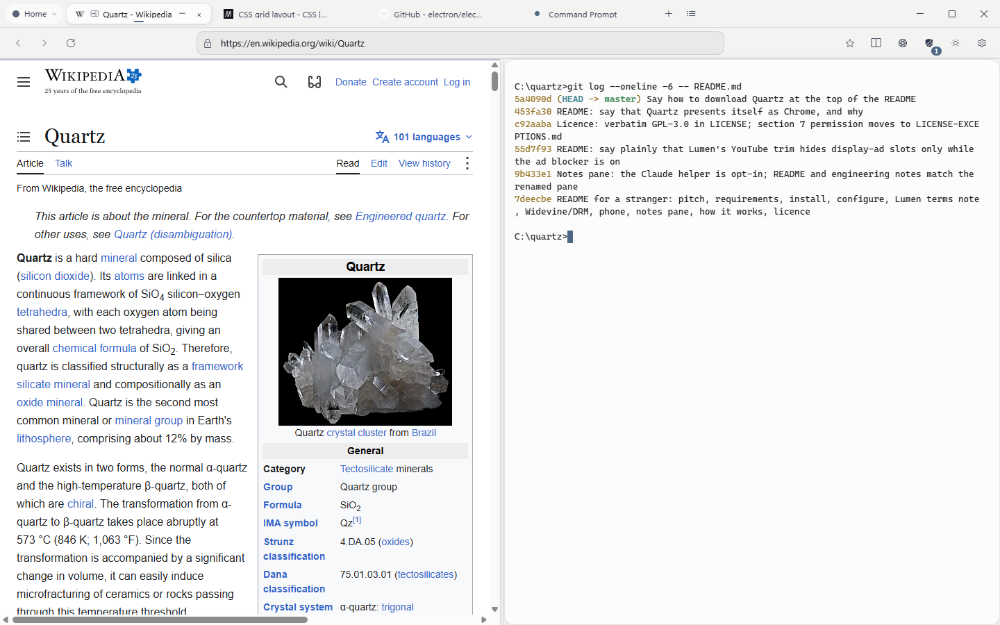

# Quartz

A Windows desktop browser built on Electron, where web pages, Claude Code sessions, terminals,
native Windows apps and your Android phone all live as tabs, with a streaming hub (Lumen) on top.



Quartz is a personal project, published so others can read it, run it and learn from it.
It is unofficial and not affiliated with any of the services it works with (see
[CREDITS.md](CREDITS.md)). **Issues welcome; pull requests are not accepted right now.**

## Download

```
git clone https://github.com/Owen-Silva/quartz.git
cd quartz
npm ci
npm start
```

There is no installer: Quartz runs from the folder you cloned. You need Windows 11 (x64),
Node.js 22.12 or newer but below 27, and git; see [Requirements](#requirements) and
[Install](#install) for the details.

## Features

- **Tabs for everything.** A tab is a web page, a real `claude.exe` (Claude Code) or shell
  session under ConPTY, a native Windows app whose own window is docked into the tab, a Files
  view, or your phone's screen.
- **Workspaces.** Coloured groups of tabs, each with an optional project folder (where a new
  Claude tab opens) and an optional side pane.
- **Search.** Any common engine, or Quartz's own results page fed by the Brave Search API
  (your key) with an optional Claude-written answer above the results (your Claude API key).
- **Blocking.** Browser-wide ad and tracker blocking with Ghostery's engine, with a per-site
  allow switch.
- **Reading and styling.** Reader mode (Mozilla Readability), per-site styles and scripts, a
  style sheet for the browser's own chrome, light and dark themes, palettes and built-in
  backgrounds.
- **New tab page.** Shortcuts, a clock, live system stats (CPU, memory, disk, network, GPU) and
  an apps dock. Every piece of it can be hidden or dragged to any spot on the page, so the
  layout is yours; hidden pieces come back where they were.
- **Autocorrect.** A misspelled word is fixed as you finish typing it, in any text box on any
  page, by the Windows spell checker. Backspace right after puts back what you typed. Password,
  email and code fields are never touched, and it can be turned off per site.
- **Lumen.** One page for what you are watching on YouTube, Disney+, Hulu, Prime Video and ESPN,
  plus live scores, a mini-player and multiview. Off until you turn services on (below).
- **Phone tab.** Your Android phone's screen in a tab, over adb and scrcpy (below).
- **Notes pane.** A folder of notes beside the page you are on (below).
- **Stocks** (your Finnhub key) and customisable keyboard shortcuts.

## Requirements

- **Windows 11, x64.** It is the only platform Quartz is built and tested on, and much of it is
  Windows-only: native app tabs (Win32 through `koffi`), ConPTY terminals, the `Quartz.exe`
  process name, the Microsoft Edge fallback for protected video, the PowerShell helpers, and the
  Segoe UI / Segoe Fluent Icons system fonts the interface uses.
- **Node.js 22.12 or newer, below 27** (the floor comes from Electron and `rcedit`, the ceiling
  from `node-pty`), with npm.
- **git**, to clone it.
- The Electron it installs is **castlabs' Electron for Content Security (ECS)**, a build of
  Electron with Widevine support, pinned in `package.json`
  (`github:castlabs/electron-releases#v44.9.3+wvcus`). npm fetches it from GitHub.

## Install

```
git clone https://github.com/Owen-Silva/quartz.git
cd quartz
npm ci
npm start
```

`npm ci` runs the `postinstall` script, `tools/make-quartz-exe.js`, which copies Electron's
`electron.exe` to `Quartz.exe` in the same folder and stamps its name and icon with `rcedit`, so
Task Manager lists Quartz as Quartz. `npm start` runs `electron .`; you can also start
`node_modules\electron\dist\Quartz.exe` with the repo folder as its argument.

The install has only been exercised on the author's machine. If `npm ci` fails (for example
while installing `@homebridge/node-pty-prebuilt-multiarch`, the terminal back end), please open
an issue with the log.

### Updating

Quartz checks this repository's GitHub releases about 30 seconds after it starts and then every
6 hours. Settings > About > **Check for updates** turns that off; **Check now** works either way.
When a new release is out, a card in the corner of the window says so:

- **Update** fetches the release's tag, moves your clone to it with `git merge --ff-only`, and
  restarts Quartz with your tabs restored. If the release changes Quartz's dependencies, it first
  runs `npm ci` in a staging folder (`.quartz-update`) while you keep browsing. That can take
  several minutes, because it downloads the pinned castlabs Electron. Quartz then closes, a small
  helper run by your `node` moves the clone to the tag and swaps the new `node_modules` in, and
  Quartz opens again.
- **Later** hides the card for a day. Settings > About still shows the release.

The Update button is only offered when the folder is a normal clone of this repository, on its
default branch, with no uncommitted changes to tracked files, and the release is a fast-forward
from where you are. Otherwise the card and Settings > About say exactly why, and show the commands
to update by hand, for example:

```
git pull --ff-only origin v0.2.0
npm ci
```

(`npm ci` only when the release changes the dependencies.) If any step fails, Quartz goes back to
the commit it was on (`git reset --keep`), keeps its old `node_modules`, says why, and points to
the log, `updater.log` in your profile folder. Quartz never checks for updates from a linked git
worktree, from a test profile, or from a folder that contains a file named `no-updates.local`.

## Configure

Everything is set in **Settings**, inside the app: Look, Claude, Tabs, Downloads, Search,
Websites, Protected video, Site styles and scripts, Browser style, New tab, Home, Idle music,
Typing, Privacy, Spotify, Lumen, Stocks, Phone, Notes pane and Shortcuts. Nothing personal is set
in the code, so you never need to edit a source file.

Your settings and data live in your profile folder, `%APPDATA%\Quartz` (Electron's `userData`),
outside the repo. The files the optional features read are:

| File | What it holds |
| --- | --- |
| `watch.json` | Lumen: which services are on, background reading, an optional TMDB key, an optional `embedReferer` for YouTube embeds |
| `phone.json` | Phone tab: your phone's address and pairing state |
| `notes-pane.json` | Notes pane: `{ "dir": "<folder of .html notes>" }` plus optional keys (see [Notes pane](#notes-pane)) |

API keys (Brave Search, Claude, TMDB, Finnhub) are pasted into Settings and stored in the profile.

## Lumen

Lumen is a page that gathers what you are watching across the services you are signed into:
Continue Watching, your YouTube subscriptions, history, Watch Later and playlists, and each
service's home rows, plus search, ESPN and NHL scores and floating score pins. A title plays in
the service's own page, trimmed down to its player, with Lumen's play bar.

**It is opt-in.** On a new install every service is off and background reading is off; turn
them on one by one in Settings > Lumen. An install that predates this choice keeps the
services it already had.

**Please read this before turning it on:**

- Lumen is **unofficial** and not affiliated with or endorsed by YouTube, Disney+, Hulu, Prime
  Video, ESPN or the NHL.
- It reads **signed-in pages with your own session**: a hidden, muted window loads the service's
  own page, and Lumen copies the data that page already shows or fetches. It stores no
  passwords, copies no cookies and calls no service API with keys of its own.
- **Automated reading may breach a service's terms of use.** Whether you use it is your call.
  Background reading ("Keep Lumen up to date in the background") is off by default.
- It **skips no in-stream ads and saves no video**: nothing is downloaded, recorded or captured.
  While the browser-wide ad blocker (the shield button in the toolbar) is on, the trimmed YouTube page also
  hides YouTube's display-ad slots, as the blocker would on any page; with it off, they stay.
- The ESPN and NHL scores come from public but undocumented feeds, used unofficially.

## Widevine and DRM

- Widevine comes from **castlabs ECS**. The Widevine Content Decryption Module is not in this
  repo; the runtime downloads and installs it the first time Quartz starts (Settings >
  Protected video shows its state).
- **A fork gets no production signing.** castlabs' stock builds carry a development signature:
  test streams play, but services such as Disney+ and Prime Video refuse it. To watch them you
  need your own free **castlabs EVS** account and must sign your build, again after every
  Electron update or `Quartz.exe` rebuild: `tools\drm-swap.ps1 -ResignOnly` does it with
  `python -m castlabs_evs.vmp sign-pkg`. The author's signature does not travel with the source.
- An unsigned build says why on a bar over the service's page and offers to **open the same page
  in Microsoft Edge** (optionally always, per service); see `drm-sites.js` and `drm.js`.
- YouTube and other unprotected video play in any build.
- **Quartz does not and will not circumvent DRM.** It plays protected video only through the
  licensed CDM, and observes the EME calls only to report their status.

## Phone tab

The Phone tab mirrors and controls an Android phone with [scrcpy](https://github.com/Genymobile/scrcpy)'s
server over adb. Quartz downloads Google's platform-tools (adb) and the scrcpy server (checked
against a pinned SHA-256) into your profile the first time you use it. On the phone, turn on
Developer options > Wireless debugging and pair once with the code it shows; put your phone's
address in Settings > Phone. The connection is meant to run over a private network such as
Tailscale, never a cable and never the open internet.

## Notes pane

Point Settings > Notes pane at a folder of `.html` notes (one file per notebook, `<section id>`s
inside) and the pane opens beside your tabs, one chip per notebook, jumping to the section that
matches what you are looking at. Until a folder is set, the pane and every way into it are hidden,
and Settings says how to turn it on. Optional keys in `notes-pane.json`, each off until set (the
full list is in the header of `notes-pane-main.js`):

| Key | What it does |
| --- | --- |
| `reader` | `{ "exe", "name", "cdpPort", "urlPatterns", "topicSelectors" }`: read the question on screen from a WebView2/Chromium desktop app over CDP, so the pane can pick the right notebook and section |
| `subjectAliases` | `{ "<notebook id>": ["phrase", ...] }`: extra words that mean that notebook |
| `helperEnabled`, `helperModel`, `claudeBin` | the optional Claude helper (off by default; also a toggle in the pane): it runs your own Claude Code CLI, using your own usage, on each new question the reader sees or one you paste |
| `budgetDir` | a folder of Claude Code statusline JSON files; when set, the helper pauses near your usage limits |

## Music auto-pause (optional companion)

Settings > Spotify connects Quartz to a separate tool, spotify-autopause: a local PowerShell
bridge (127.0.0.1, the first free port of 8787-8790) run by a scheduled task, which pauses
Spotify while something else plays sound. Quartz is only a client: it can switch that task on
and off, and its tabs that play audio on a watched site register a hold with the bridge. Without
the tool installed, Settings says so and nothing else changes.

## How it works, and why it is built this way

- **Electron, not Tauri.** Tauri's build needs a C++ toolchain and the build machine had none;
  Electron ships its own Chromium and needs nothing compiled (`koffi` and `node-pty` install
  from prebuilt binaries).
- **Process split.** The main process is a set of plain CommonJS modules, one per area
  (`main.js` wires them: `pty.js`, `embed.js`, `phone.js`, `watch-main.js`, `drm-main.js`, ...).
  The window's renderer is plain browser scripts loaded by `index.html` (`app.js`,
  `settings.js`, ...) with no `require`, `contextIsolation` on and `nodeIntegration` off. The
  only bridge is `preload.js`, which exposes one `window.api` object.
- **One `<webview>` per tab.** Each page is its own guest, and `will-attach-webview` strips any
  preload or Node access a guest asks for and pins the security switches, so no page can raise
  its own privileges.
- **Bundled pages talk over console lines.** The new tab, history, files, search and Lumen pages
  are `file://` guests with no preload. They ask for things by writing one prefixed console line
  (`newtab:end-task {...}`); the chrome checks which page sent it, parses and validates it,
  acts, and answers by calling a function on the page.
- **Lumen reads in hidden windows.** One off-screen, muted window at a time loads a service's
  page on your normal session, reads the page's embedded state, and captures the JSON the page
  fetches through the Chrome DevTools Protocol on that window only. Only the reduced list of
  titles is cached (`watch-cache.json`); the window is closed when the read ends.
- **Ghostery's engine** owns the default session's request hooks for blocking, so everything
  else that watches requests goes through CDP or its own session instead.
- **It presents itself as Chrome.** Quartz sends a plain Chrome user agent and a "Google Chrome"
  brand in its client hints (`installClientHintFix` in `main.js`), so sites that turn away
  unknown browsers, such as X's login, accept it.
- **castlabs ECS for Widevine**, because stock Electron ships no CDM and ECS is the supported way
  to get one, with signing (EVS) that replaces a direct licence agreement with Google.
- **No silent failures.** Anything off, missing or refused says so, with its reason, in the
  place it affects.
- **Testing.** Pure-node harnesses test the logic with no Electron (`node tools/run-suite.js
  --unit`). End-to-end tests launch a real off-screen instance on a throwaway profile
  (`--test-profile`, under `%TEMP%`) and drive it over the DevTools Protocol. They never touch
  your own profile.

The full design log, part by part, is [docs/engineering-notes.md](docs/engineering-notes.md);
what changed and why is in [CHANGELOG.md](CHANGELOG.md).

## Licence

Quartz is licensed under the **GNU General Public License, version 3 only** (`GPL-3.0-only`); see
[LICENSE](LICENSE). [LICENSE-EXCEPTIONS.md](LICENSE-EXCEPTIONS.md) adds a section 7 permission to
combine Quartz with Electron (including castlabs ECS), Chromium and the proprietary Widevine CDM
and to convey the combination.

Not everything in the repo is under the GPL: the background photos (Unsplash License) and the
Brave logo (a Brave Software trademark) are carved out, and third-party notices are collected in
[CREDITS.md](CREDITS.md).

Copyright (C) 2026 Owen Silva. Issues welcome; pull requests are not accepted right now.
